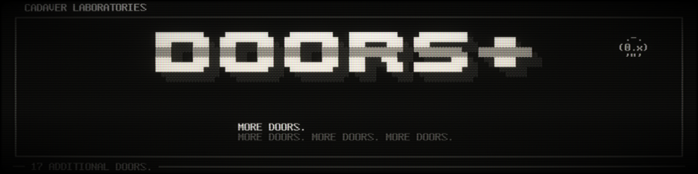
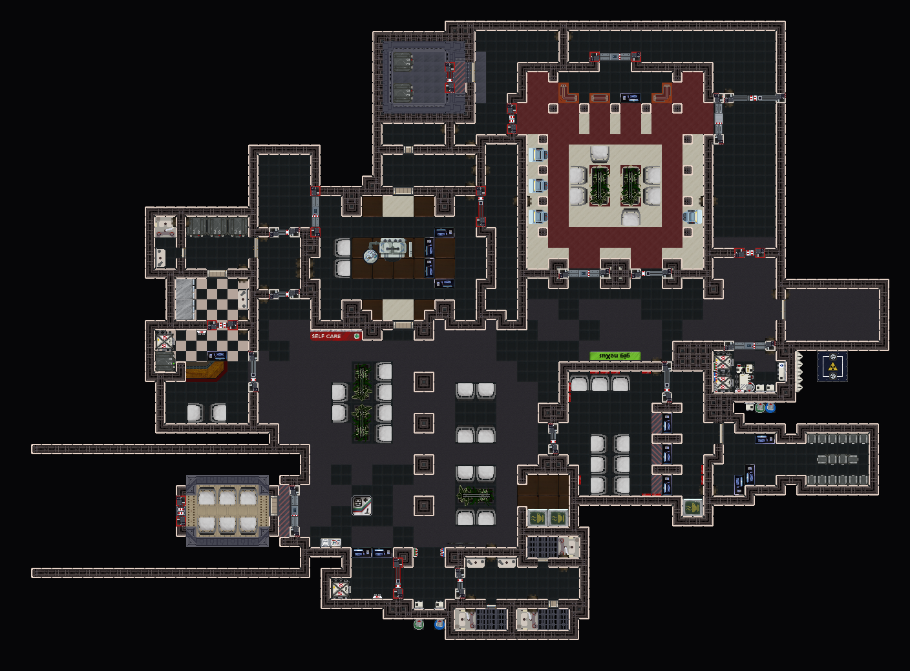
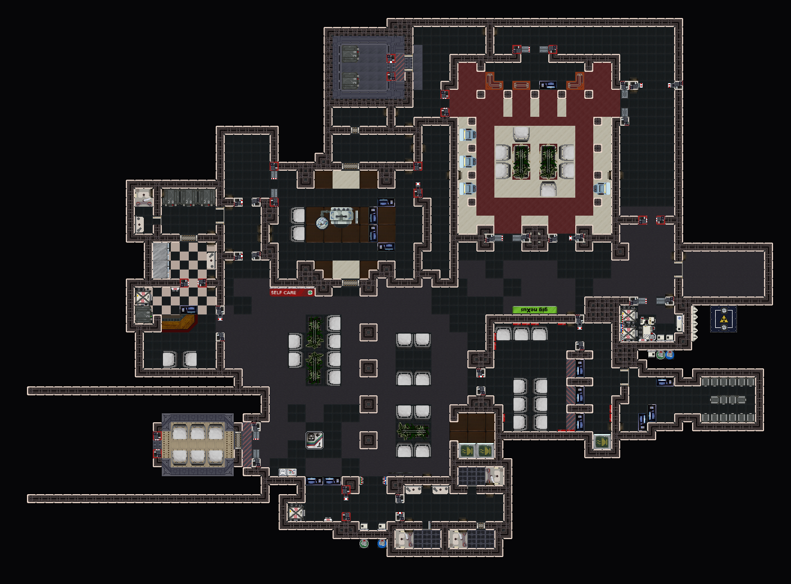
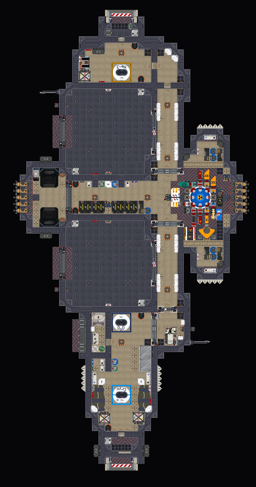
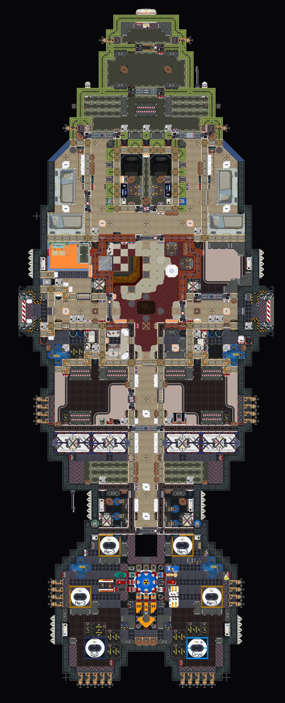
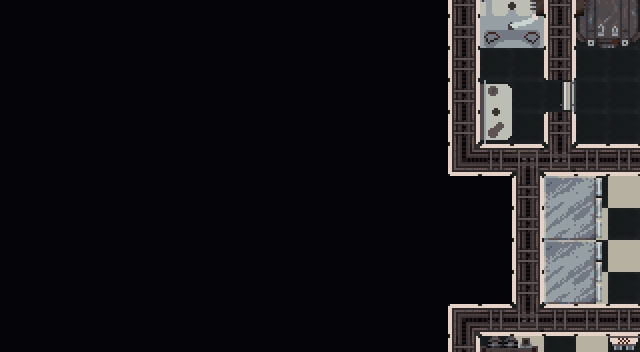
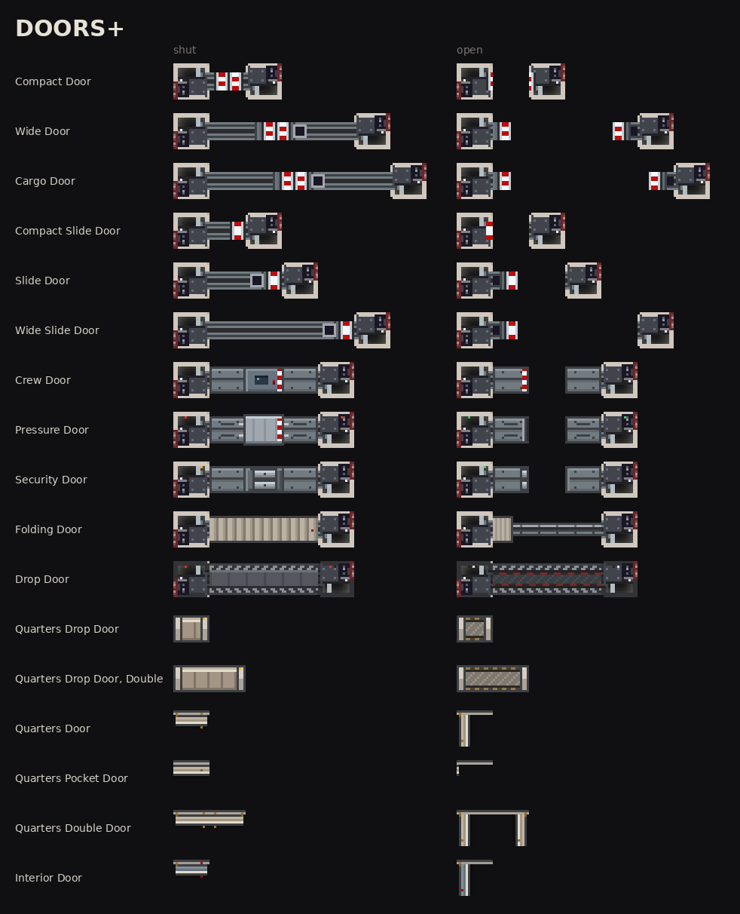
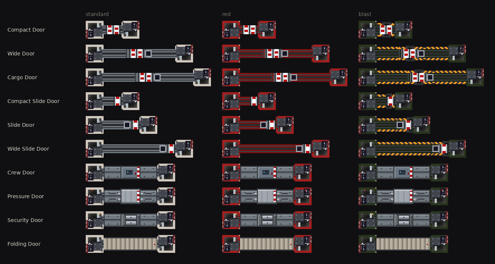
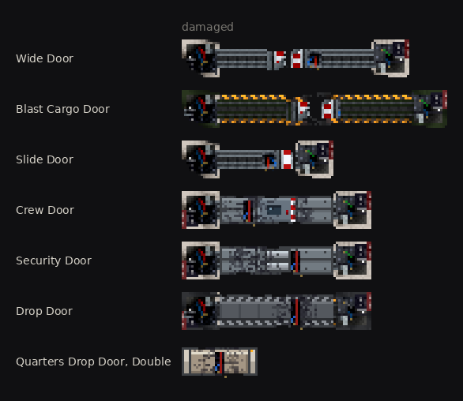

```text
 .-.   CADAVER LABORATORIES
(0.x)  DOORS+ // MORE DOORS.
 '"'   MORE DOORS. MORE DOORS. MORE DOORS.
```

# DOORS+ for Ostranauts
**By Cadaver** | Cadaver Laboratories | MIT | mod 0.1.0 for Ostranauts 1.0.1.5 | no plugin

> More doors.

Doors+ adds 17 new doors. They open. They close. They lock, unlock, take power and signals, shut themselves behind
you, and can be pried open when they will not. Your crew walks through them on their own, same as the game's door.

They are built from the game's own door and hatch, so they behave like them: same lock panel, same wiring, same
damage and repair, same pry bar. Let me know if a door can't do something it needs to.

```text
▄▄▄▄▄▄                              ▄▄▄▄▄▄  ▄▄▄▄▄▄      ▄▄▄▄▄▄
█▓▓▓▓█══════════════════════════════█▓▓▓▓█  █▓▓▓▓█══════█▓▓▓▓█
█▓░░▓█▒▒▒▒▒▒▒▒▒▒▒▒▒█░░█▐▌▒▒▒▒▒▒▒▒▒▒▒█▓░░▓█  █▓░░▓█▒█░░█▒█▓░░▓█
█▓▓▓▓█══════════════════════════════█▓▓▓▓█  █▓▓▓▓█══════█▓▓▓▓█
▀▀▀▀▀▀                              ▀▀▀▀▀▀  ▀▀▀▀▀▀      ▀▀▀▀▀▀
▄▄▄▄▄▄                        ▄▄▄▄▄▄  ▄▄▄▄▄▄            ▄▄▄▄▄▄
█▓▓▓▓█════════════════════════█▓▓▓▓█  █▓▓▓▓█════════════█▓▓▓▓█
█▓░░▓█▒▒▒▒▒▒▒▒▒▒█░░█▐▌▒▒▒▒▒▒▒▒█▓░░▓█  █▓░░▓██░█▒▒▒▒▒▒▒▐▌█▓░░▓█
█▓▓▓▓█════════════════════════█▓▓▓▓█  █▓▓▓▓█════════════█▓▓▓▓█
▀▀▀▀▀▀                        ▀▀▀▀▀▀  ▀▀▀▀▀▀            ▀▀▀▀▀▀
▄▄▄▄▄▄                        ▄▄▄▄▄▄  ▄▄▄▄▄▄      ▄▄▄▄▄▄  ▄▄▄▄▄▄
█▓▓▓▓█════════════════════════█▓▓▓▓█  █▓▓▓▓█══════█▓▓▓▓█  █▓▓▓▓█
█▓░░▓██░█▒▒▒▒▒▒▒▒▒▒▒▒▒▒▒▒▒▒▒▐▌█▓░░▓█  █▓░░▓██░█▒▐▌█▓░░▓█  █▓▓▓▓█
█▓▓▓▓█════════════════════════█▓▓▓▓█  █▓▓▓▓█══════█▓▓▓▓█  █▓▓▓▓█
▀▀▀▀▀▀                        ▀▀▀▀▀▀  ▀▀▀▀▀▀      ▀▀▀▀▀▀  ▀▀▀▀▀▀
▄▄▄▄▄▄                  ▄▄▄▄▄▄  ▄▄▄▄▄▄                  ▄▄▄▄▄▄
█▓▓▓▓█═════┌──┐═════════█▓▓▓▓█  █▓▓▓▓█║▓▓▓▓▓▓▓▓▓▓▓▓▓▓▓▓║█▓▓▓▓█
█▓░░▓██░█▒▒│  │▒▒▒▒▒▒▒▒▒█▓░░▓█  █▓░░▓█║▓▓▓▓▓▓▓██▓▓▓▓▓▓▓║█▓░░▓█
█▓▓▓▓█═════└──┘═════════█▓▓▓▓█  █▓▓▓▓█║▓▓▓▓▓▓▓▓▓▓▓▓▓▓▓▓║█▓▓▓▓█
▀▀▀▀▀▀                  ▀▀▀▀▀▀  ▀▀▀▀▀▀                  ▀▀▀▀▀▀
▄▄▄▄▄▄                  ▄▄▄▄▄▄  ▄▄▄▄▄▄                  ▄▄▄▄▄▄
█▓▓▓▓█▓▓▓▓▓▓▓▓▐█▓▓▓▓▓▓▓▓█▓▓▓▓█  █▓▓▓▓█/\/\/\/\/\/\/\/\/\█▓▓▓▓█
█▓░░▓█▓▓▓▓▓▓▓▓█▌▓▓▓▓▓▓▓▓█▓░░▓█  █▓░░▓█\/\/\/\/\/\/\/\/\/█▓░░▓█
█▓▓▓▓█▓▓▓▓▓▓▓▓▐█▓▓▓▓▓▓▓▓█▓▓▓▓█  █▓▓▓▓█/\/\/\/\/\/\/\/\/\█▓▓▓▓█
▀▀▀▀▀▀                  ▀▀▀▀▀▀  ▀▀▀▀▀▀──────────────────▀▀▀▀▀▀
▄▄▄▄▄▄▀▄▀▄▀▄▀▄▀▄▀▄▀▄▀▄▀▄▄▄▄▄▄▄  ▄▄▄▄▄▄▄▄▄▄▄▄  ┌──────────┐  ┌────┐
█▓▓▓▓█▓▓▓▓▓▓▓▓▓▓▓▓▓▓▓▓▓▓█▓▓▓▓█  █▓▓▓▓▓▓▓▓▓▓█  │▒▒▒▒││▒▒▒▒│  │▒▒▒▒│
█▓░░▓█▓▓▓▓▓▓▓▓▓▓▓▓▓▓▓▓▓▓█▓░░▓█  █▓▓▓▓▓▓▓▓▓▓█  │▒▒▒▒││▒▒▒▒│  │▒▒▒▒│
█▓▓▓▓█▓▓▓▓▓▓▓▓▓▓▓▓▓▓▓▓▓▓█▓▓▓▓█  █▓▓▓▓▓▓▓▓▓▓█  │▒▒▒▒││▒▒▒▒│  │▒▒▒▒│
▀▀▀▀▀▀▄▀▄▀▄▀▄▀▄▀▄▀▄▀▄▀▄▀▀▀▀▀▀▀  ▀▀▀▀▀▀▀▀▀▀▀▀  └──────────┘  └────┘
┌────┐▄▄▄▄▄▄  ┌────┐
│▒▒▒▒│██████  │▓▓▓▓│
│▒▒▒▒│██████  │▓▓▓▓│
│▒▒▒▒│██████  │▓▓▓▓│
└────┘▀▀▀▀▀▀  └────┘
```

---

## The doors

Each door shut on the left, open on the right.

### More game doors
We got the standard door, in more sizes of course. As well as the red and blast door. Smaller doors for smaller
problems. Larger doors for, more airflow? Drawn from the game door's own housings, track and leaves, so they sit
next to a stock door without looking like a mod.

```text
COMPACT DOOR  3 tiles
▄▄▄▄▄▄      ▄▄▄▄▄▄                              ▄▄▄▄▄▄      ▄▄▄▄▄▄
█▓▓▓▓█══════█▓▓▓▓█                              █▓▓▓▓█══  ══█▓▓▓▓█
█▓░░▓█▒█░░█▒█▓░░▓█                              █▓░░▓██░  ░██▓░░▓█
█▓▓▓▓█══════█▓▓▓▓█                              █▓▓▓▓█══  ══█▓▓▓▓█
▀▀▀▀▀▀      ▀▀▀▀▀▀                              ▀▀▀▀▀▀      ▀▀▀▀▀▀

WIDE DOOR  6 tiles
▄▄▄▄▄▄                        ▄▄▄▄▄▄            ▄▄▄▄▄▄                        ▄▄▄▄▄▄
█▓▓▓▓█════════════════════════█▓▓▓▓█            █▓▓▓▓█══                    ══█▓▓▓▓█
█▓░░▓█▒▒▒▒▒▒▒▒▒▒█░░█▐▌▒▒▒▒▒▒▒▒█▓░░▓█            █▓░░▓██░                    ░██▓░░▓█
█▓▓▓▓█════════════════════════█▓▓▓▓█            █▓▓▓▓█══                    ══█▓▓▓▓█
▀▀▀▀▀▀                        ▀▀▀▀▀▀            ▀▀▀▀▀▀                        ▀▀▀▀▀▀

CARGO DOOR  7 tiles
▄▄▄▄▄▄                              ▄▄▄▄▄▄      ▄▄▄▄▄▄                              ▄▄▄▄▄▄
█▓▓▓▓█══════════════════════════════█▓▓▓▓█      █▓▓▓▓█══                          ══█▓▓▓▓█
█▓░░▓█▒▒▒▒▒▒▒▒▒▒▒▒▒█░░█▐▌▒▒▒▒▒▒▒▒▒▒▒█▓░░▓█      █▓░░▓██░                          ░██▓░░▓█
█▓▓▓▓█══════════════════════════════█▓▓▓▓█      █▓▓▓▓█══                          ══█▓▓▓▓█
▀▀▀▀▀▀                              ▀▀▀▀▀▀      ▀▀▀▀▀▀                              ▀▀▀▀▀▀
```

| Door | Tiles | Looks | Price | Maker |
| :--- | :---: | :--- | ---: | :--- |
| **Compact Door** | 3 | standard, red, blast | 1602 cr | standard issue |
| **Wide Door** | 6 | standard, red, blast | 3204 cr | standard issue |
| **Cargo Door** | 7 | standard, red, blast | 3738 cr | standard issue |

### Sliding doors
The same doors with one... door. Opening to whichever side you turn them to. Rotate before placing to pick the side.

```text
COMPACT SLIDE DOOR  3 tiles
▄▄▄▄▄▄      ▄▄▄▄▄▄                        ▄▄▄▄▄▄      ▄▄▄▄▄▄
█▓▓▓▓█══════█▓▓▓▓█                        █▓▓▓▓█   ═══█▓▓▓▓█
█▓░░▓██░█▒▐▌█▓░░▓█                        █▓░░▓█   █░██▓░░▓█
█▓▓▓▓█══════█▓▓▓▓█                        █▓▓▓▓█   ═══█▓▓▓▓█
▀▀▀▀▀▀      ▀▀▀▀▀▀                        ▀▀▀▀▀▀      ▀▀▀▀▀▀

SLIDE DOOR  4 tiles
▄▄▄▄▄▄            ▄▄▄▄▄▄                  ▄▄▄▄▄▄            ▄▄▄▄▄▄
█▓▓▓▓█════════════█▓▓▓▓█                  █▓▓▓▓█         ═══█▓▓▓▓█
█▓░░▓██░█▒▒▒▒▒▒▒▐▌█▓░░▓█                  █▓░░▓█         █░██▓░░▓█
█▓▓▓▓█════════════█▓▓▓▓█                  █▓▓▓▓█         ═══█▓▓▓▓█
▀▀▀▀▀▀            ▀▀▀▀▀▀                  ▀▀▀▀▀▀            ▀▀▀▀▀▀

WIDE SLIDE DOOR  6 tiles
▄▄▄▄▄▄                        ▄▄▄▄▄▄      ▄▄▄▄▄▄                        ▄▄▄▄▄▄
█▓▓▓▓█════════════════════════█▓▓▓▓█      █▓▓▓▓█                     ═══█▓▓▓▓█
█▓░░▓██░█▒▒▒▒▒▒▒▒▒▒▒▒▒▒▒▒▒▒▒▐▌█▓░░▓█      █▓░░▓█                     █░██▓░░▓█
█▓▓▓▓█════════════════════════█▓▓▓▓█      █▓▓▓▓█                     ═══█▓▓▓▓█
▀▀▀▀▀▀                        ▀▀▀▀▀▀      ▀▀▀▀▀▀                        ▀▀▀▀▀▀
```

| Door | Tiles | Looks | Price | Maker |
| :--- | :---: | :--- | ---: | :--- |
| **Compact Slide Door** | 3 | standard, red, blast | 1602 cr | standard issue |
| **Slide Door** | 4 | standard, red, blast | 2136 cr | standard issue |
| **Wide Slide Door** | 6 | standard, red, blast | 3204 cr | standard issue |

### Specialist doors
Five tiles wide, standard, red and blast housings.

* **Crew Door:** one panel with a vision port, sliding to one side. The everyday door.
* **Pressure Door:** Bieler. A heavy slab on a gasket that holds pressure well past the standard door.
* **Security Door:** Langdon-Phillips. Two armoured leaves that lock on interlocking bolts. Takes a beating.
* **Folding Door:** a light accordion door on a floor track. Cheap and quiet.

> [!CAUTION]
> **The Folding Door is not a pressure door. Please stop using it as one.**

```text
CREW DOOR  5 tiles
▄▄▄▄▄▄                  ▄▄▄▄▄▄      ▄▄▄▄▄▄                  ▄▄▄▄▄▄
█▓▓▓▓█═════┌──┐═════════█▓▓▓▓█      █▓▓▓▓█               ═══█▓▓▓▓█
█▓░░▓██░█▒▒│  │▒▒▒▒▒▒▒▒▒█▓░░▓█      █▓░░▓█               █░██▓░░▓█
█▓▓▓▓█═════└──┘═════════█▓▓▓▓█      █▓▓▓▓█               ═══█▓▓▓▓█
▀▀▀▀▀▀                  ▀▀▀▀▀▀      ▀▀▀▀▀▀                  ▀▀▀▀▀▀

PRESSURE DOOR  5 tiles
▄▄▄▄▄▄                  ▄▄▄▄▄▄      ▄▄▄▄▄▄                  ▄▄▄▄▄▄
█▓▓▓▓█║▓▓▓▓▓▓▓▓▓▓▓▓▓▓▓▓║█▓▓▓▓█      █▓▓▓▓█║                ║█▓▓▓▓█
█▓░░▓█║▓▓▓▓▓▓▓██▓▓▓▓▓▓▓║█▓░░▓█      █▓░░▓█║                ║█▓░░▓█
█▓▓▓▓█║▓▓▓▓▓▓▓▓▓▓▓▓▓▓▓▓║█▓▓▓▓█      █▓▓▓▓█║                ║█▓▓▓▓█
▀▀▀▀▀▀                  ▀▀▀▀▀▀      ▀▀▀▀▀▀                  ▀▀▀▀▀▀

SECURITY DOOR  5 tiles
▄▄▄▄▄▄                  ▄▄▄▄▄▄      ▄▄▄▄▄▄                  ▄▄▄▄▄▄
█▓▓▓▓█▓▓▓▓▓▓▓▓▐█▓▓▓▓▓▓▓▓█▓▓▓▓█      █▓▓▓▓█▓▐              █▓█▓▓▓▓█
█▓░░▓█▓▓▓▓▓▓▓▓█▌▓▓▓▓▓▓▓▓█▓░░▓█      █▓░░▓█▓█              ▌▓█▓░░▓█
█▓▓▓▓█▓▓▓▓▓▓▓▓▐█▓▓▓▓▓▓▓▓█▓▓▓▓█      █▓▓▓▓█▓▐              █▓█▓▓▓▓█
▀▀▀▀▀▀                  ▀▀▀▀▀▀      ▀▀▀▀▀▀                  ▀▀▀▀▀▀

FOLDING DOOR  5 tiles
▄▄▄▄▄▄                  ▄▄▄▄▄▄      ▄▄▄▄▄▄                  ▄▄▄▄▄▄
█▓▓▓▓█/\/\/\/\/\/\/\/\/\█▓▓▓▓█      █▓▓▓▓█/\/\              █▓▓▓▓█
█▓░░▓█\/\/\/\/\/\/\/\/\/█▓░░▓█      █▓░░▓█\/\/              █▓░░▓█
█▓▓▓▓█/\/\/\/\/\/\/\/\/\█▓▓▓▓█      █▓▓▓▓█/\/\              █▓▓▓▓█
▀▀▀▀▀▀──────────────────▀▀▀▀▀▀      ▀▀▀▀▀▀──────────────────▀▀▀▀▀▀
```

| Door | Tiles | Looks | Price | Maker |
| :--- | :---: | :--- | ---: | :--- |
| **Crew Door** | 5 | standard, red, blast | 2900 cr | standard issue |
| **Pressure Door** | 5 | standard, red, blast | 6900 cr | Bieler |
| **Security Door** | 5 | standard, red, blast | 9400 cr | Langdon-Phillips |
| **Folding Door** | 5 | standard, red, blast | 1100 cr | standard issue |

### Drop doors
The slab sinks into the deck and the doorway becomes floor. A Drop Door is the floor where it stands: install one and
it takes the floor's place, uninstall one and the floor goes with it...

> [!WARNING]
> **Uninstalling a drop door removes the floor under it.** Check which side of it you are standing on.

```text
DROP DOOR  5 tiles
▄▄▄▄▄▄▀▄▀▄▀▄▀▄▀▄▀▄▀▄▀▄▀▄▄▄▄▄▄▄      ▄▄▄▄▄▄▀▄▀▄▀▄▀▄▀▄▀▄▀▄▀▄▀▄▄▄▄▄▄▄
█▓▓▓▓█▓▓▓▓▓▓▓▓▓▓▓▓▓▓▓▓▓▓█▓▓▓▓█      █▓▓▓▓█░░░░░░░░░░░░░░░░░░█▓▓▓▓█
█▓░░▓█▓▓▓▓▓▓▓▓▓▓▓▓▓▓▓▓▓▓█▓░░▓█      █▓░░▓█░░░░░░░░░░░░░░░░░░█▓░░▓█
█▓▓▓▓█▓▓▓▓▓▓▓▓▓▓▓▓▓▓▓▓▓▓█▓▓▓▓█      █▓▓▓▓█░░░░░░░░░░░░░░░░░░█▓▓▓▓█
▀▀▀▀▀▀▄▀▄▀▄▀▄▀▄▀▄▀▄▀▄▀▄▀▀▀▀▀▀▀      ▀▀▀▀▀▀▄▀▄▀▄▀▄▀▄▀▄▀▄▀▄▀▄▀▀▀▀▀▀▀

QUARTERS DROP DOOR  1 tile
▄▄▄▄▄▄                              ▄▄▄▄▄▄
█▓▓▓▓█                              █░░░░█
█▓▓▓▓█                              █░░░░█
█▓▓▓▓█                              █░░░░█
▀▀▀▀▀▀                              ▀▀▀▀▀▀

QUARTERS DROP DOOR, DOUBLE  2 tiles
▄▄▄▄▄▄▄▄▄▄▄▄                        ▄▄▄▄▄▄▄▄▄▄▄▄
█▓▓▓▓▓▓▓▓▓▓█                        █░░░░░░░░░░█
█▓▓▓▓▓▓▓▓▓▓█                        █░░░░░░░░░░█
█▓▓▓▓▓▓▓▓▓▓█                        █░░░░░░░░░░█
▀▀▀▀▀▀▀▀▀▀▀▀                        ▀▀▀▀▀▀▀▀▀▀▀▀
```

| Door | Tiles | Looks | Price | Maker |
| :--- | :---: | :--- | ---: | :--- |
| **Drop Door** | 5 | one | 12800 cr | Langdon-Phillips |
| **Quarters Drop Door** | 1 | one | 940 cr | Testudo |
| **Quarters Drop Door, Double** | 2 | one | 1500 cr | Testudo |

### Quarters doors
For the closet, the latrine and the cabin you share with someone you did not choose. Hinged, opened by hand, a wall
when shut. They act like the game's hatch, just in a doorway instead of a floor.

```text
QUARTERS DOOR  1 tile
┌────┐            ┌────┐
│▒▒▒▒│            │▀▀▀▀│
│▒▒▒▒│            │    │
│▒▒▒▒│            │    │
└────┘            └────┘

QUARTERS POCKET DOOR  1 tile
┌────┐▄▄▄▄▄▄      ┌────┐▄▄▄▄▄▄
│▒▒▒▒│██████      │    │██████
│▒▒▒▒│██████      │    │█▒▒▒▒█
│▒▒▒▒│██████      │    │██████
└────┘▀▀▀▀▀▀      └────┘▀▀▀▀▀▀

QUARTERS DOUBLE DOOR  2 tiles
┌──────────┐      ┌──────────┐
│▒▒▒▒││▒▒▒▒│      │▀▀▀▀  ▀▀▀▀│
│▒▒▒▒││▒▒▒▒│      │          │
│▒▒▒▒││▒▒▒▒│      │          │
└──────────┘      └──────────┘

INTERIOR DOOR  1 tile
┌────┐            ┌────┐
│▓▓▓▓│            │▀▀▀▀│
│▓▓▓▓│            │    │
│▓▓▓▓│            │    │
└────┘            └────┘
```

| Door | Tiles | Looks | Price | Maker |
| :--- | :---: | :--- | ---: | :--- |
| **Quarters Door** | 1 | one | 420 cr | Testudo |
| **Quarters Pocket Door** | 1 | one | 480 cr | Testudo |
| **Quarters Double Door** | 2 | one | 760 cr | Testudo |
| **Interior Door** | 1 | one | 380 cr | standard issue |

---

## Screenshots

K-Leg, a Bulk Lifter and a Babak, every door swapped for a Doors+ door.

| K-Leg, shut | K-Leg, open |
| :---: | :---: |
|  |  |

| Bulk Lifter holds | Babak |
| :---: | :---: |
|  |  |



| Every door, shut and open | Every look | Damaged |
| :---: | :---: | :---: |
|  |  |  |

---

## Using them

| Action | What happens |
| :--- | :--- |
| **Place** | Install a loose door in a wall line, like the game's door. You got this. Its frame tiles become wall, so sensors, panels and lights mount on them. |
| **Open** | Walk up to it or click it. Powered doors close behind you. Quarters doors act more like the hatch in game. |
| **Lock** | Use the lock panel, key or PIN, as on the game's door. |
| **No power** | A powered door without power is stuck shut. Pry it open. |
| **Turn** | Rotate a slide door before placing it to choose its side. |
| **Drop doors** | Open, the doorway is floor. Uninstalled, there is no floor. |
| **Small doors** | Opened and shut by hand, standing: about 3 game seconds. Slower than a powered door, a lot faster than the hatch (about 20). |
| **Damage** | Doors take damage like the game's door, show it, and repair or dismantle with the game's own recipes. |
| **Signals** | Powered doors take signals the same way the game's door does. |

---

## Install

* **Steam Workshop:** subscribe, then enable `Doors+` in the game's Mods menu.
* **By hand:** copy the `DoorsPlus` folder to `Ostranauts_Data/Mods/DoorsPlus` and add
  `"DoorsPlus"` to the `aLoadOrder` array in `Ostranauts_Data/Mods/loading_order.json`.

There is no plugin. There is nothing else to install. Maybe I'll add a plugin if people want custom sounds or
animations.

Station markets that trade hull parts can carry them.

> [!TIP]
> **Console spawning**
> Open the console (`` ` `` backtick key) and run:
> ```bash
> spawn ItmCdvDoor6ClosedLoose
> ```
> Every name is in [`DoorsPlus/README.txt`](DoorsPlus/README.txt). Red and blast looks add `Red` or `Blast` after the door's
> name, for example `ItmCdvCrewBlastClosedLoose`.

---

## Compatibility

Doors+ replaces three of the game's entries, the ones the game's code calls by name:

| Entry | Why |
| :--- | :--- |
| `MSPortalOpenStart` | your crew opening doors as they walk |
| `MSLock` | the lock panel |
| `MSUnlock` | the lock panel |

Everything else is its own, with its own names, so it sits alongside other mods. If another door or lock mod replaces
those three too, load Doors+ after it. Removing Doors+ from a save that has its doors installed leaves holes where
the doors were (and no floor under drop doors).

## License

MIT. Made by Cadaver.

Cadaver Laboratories accepts no responsibility or warranties. In general. Luv u <3
